---
> **Firmware:** `bp_modbus_gateway_lcd_v11` v1.0.7  
> **Platform:** Tibbo TPP2W(G2) in a TPB2L enclosure

 

---

## Bookmarks

- [1. Overview](#1-overview)
- [2. Hardware and interfaces](#2-hardware-and-interfaces)
- [3. Network configuration and services](#3-network-configuration-and-services)
- [4. Device Console](#4-device-console)
  - [4.1 Home](#41-home)
  - [4.2 Settings](#42-settings)
    - [4.2.1 General](#421-general)
    - [4.2.2 Wi-Fi](#422-wi-fi)
    - [4.2.3 Modbus channels](#423-modbus-channels)
  - [4.3 Log](#43-log)
    - [4.3.1 Debug](#431-debug)
    - [4.3.2 Log](#432-log)
  - [4.4 System](#44-system)
    - [4.4.1 Commands](#441-commands)
    - [4.4.2 Time](#442-time)
- [5. Deployment example](#5-deployment-example)
  - [5.1 Connect the Modbus RTU devices](#51-connect-the-modbus-rtu-devices)
  - [5.2 Connect the network and power](#52-connect-the-network-and-power)
  - [5.3 Connect to the Device Console](#53-connect-to-the-device-console)
  - [5.4 Configure General](#54-configure-network-in-general)
  - [5.5 Configure Wi-Fi](#55-configure-wi-fi)
  - [5.6 Configure Channels](#56-configure-channels)
    - [5.6.1 Screenshot of Configuration of CH1](#561-screenshot-of-configuration-of-ch1)
    - [5.6.2 Screenshot of Configuration of CH2](#562-screenshot-of-configuration-of-ch2)
  - [5.7 Reboot Device](#57-reboot-device)
    - [5.7.1 Verify Wi-Fi Connection](#571-verify-wi-fi-connection)
  - [5.8 TCP-to-Modbus Test Software](#58-tcp-to-modbus-test-software)
    - [5.8.1 Download and Install](#581-download-and-install)
    - [5.8.2 Configuration](#582-configuration)
    - [5.8.3 Start Connection](#583-start-connection)
    - [5.8.4 Check Result](#584-check-result)
      - [5.8.4.1 Table](#5841-table)
      - [5.8.4.2 Live Chart](#5842-livechart)
  - [5.9 LCD Status](#59-lcd-status)
- [6. Commissioning checklist](#6-commissioning-checklist)
- [7. Troubleshooting](#7-troubleshooting)

  

---

## 1. Overview [↑](#bookmarks "Back to Bookmarks")

The Tibbo Modbus Gateway connects a Modbus TCP client on an Ethernet or Wi-Fi
network to up to four independent Modbus RTU buses. It is intended for systems
where a SCADA system, PLC, HMI, or other Modbus TCP master must communicate
with serial Modbus field devices. It operates as a **Modbus TCP-to-RTU
pass-through gateway**.

Each TCP listening port is assigned to one RTU channel. When a Modbus TCP
client sends a request to a channel's port, the gateway forwards the request
to the associated RS-485 bus using the original Modbus unit ID. The reply from
the RTU device is returned to the TCP client. The gateway does not
independently poll field devices, store register values, or initiate Modbus
requests without a request from a Modbus TCP client.

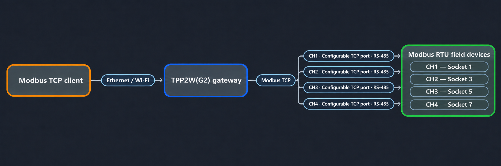

---

## 2. Hardware and interfaces [↑](#bookmarks "Back to Bookmarks")

| Item | Detail |
| --- | --- |
| Controller | Tibbo TPP2W(G2) Tibbo Project PCB |
| Enclosure | TPB2L, DIN-rail mounting kit, vibration-proof kit |
| Network | On-board 10/100 Base-T Ethernet with RJ45 |
| Wireless network | WA2000 Wi-Fi module |
| Field interfaces | Four Tibbit #05 RS-485 ports in sockets 1, 3, 5, and 7 |
| Field connector | 2× Tibbit #20 (9-terminal block) |
| Power | Tibbit #10 power supply module in socket 11 |
| Power adapter | APR-P0008 adapter |
| Storage | 1 MB AT45DB081E dataflash, LittleFS file system |
| Display | 320 × 240 LCD showing network and channel status |
| Status LEDs | On-board red/green LEDs and LCD channel indicators |
| MD button | Provides an audible indication when pressed; it does not reset settings in this firmware |
| RST button | Restarts the device |

  

---

## 3. Network configuration and services [↑](#bookmarks "Back to Bookmarks")

| Service | Setting |
| --- | --- |
| Ethernet | static IP/netmask/gateway, or DHCP  |
| Wi-Fi | Station mode; DHCP or static IP/netmask/gateway; SSID, security type, and password |
| Device Console | HTTP on port `80` |
| Modbus TCP | Four configurable TCP listening ports; default ports `502`, `503`, `504`,`505` |
| Time sync | SNTP against 216.239.35.0 (time.google.com), applied with the configured time zone |
| Device Console | HTTP, port 80, 3 concurrent connections |

 

> **Ethernet:**
> - Out of the box, Ethernet DHCP is **disabled** and the device uses the
>   **default** static IP address `192.168.1.40`. This placeholder makes the
>   device reachable on first power-up; change it to match your network.
> - When Ethernet DHCP is enabled, use the address assigned by your DHCP server
>   instead.

> **Wi-Fi:**
> - Wi-Fi is enabled in **Station** mode with DHCP enabled, but is not
>   configured to join a network until you enter its SSID and password.
> - A **network connection** is required for Device Console access, Modbus TCP
>   communication, and time synchronization.

  

---

## 4. Device Console [↑](#bookmarks "Back to Bookmarks")

The browser-based configuration interface is called the **Device Console**.
Open `http://<device-ip>` in a supported web browser.

> **NOTE:**
> The browser-based configuration interface is called the **Device Console**. It
> may also be referred to as the Web Console in AppBlocks documentation.

 

### 4.1 Home [↑](#bookmarks "Back to Bookmarks")

On the **Home** page, general gateway information is displayed.

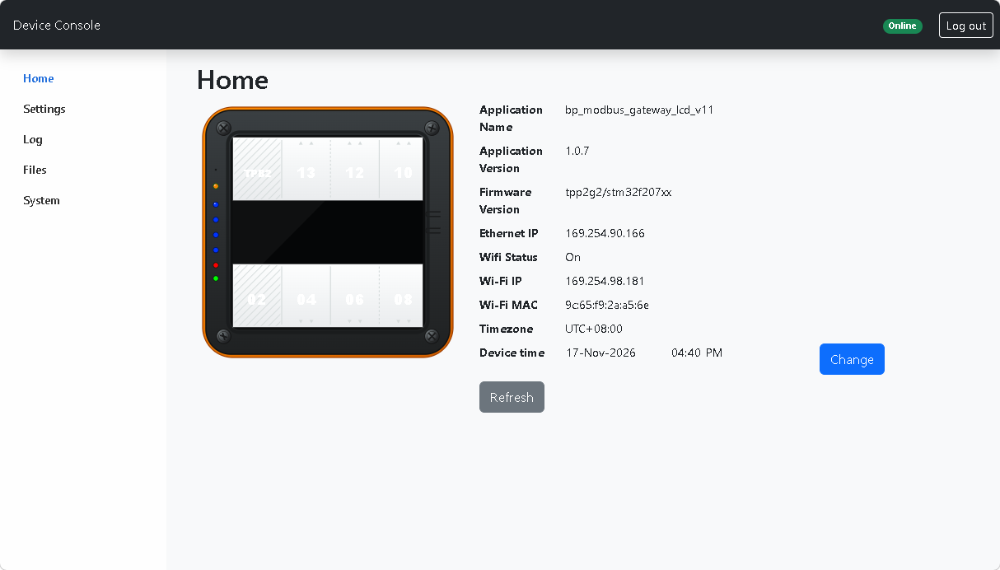

> **NOTE:**
> - Select **Refresh** to update the displayed information.
> - Use **Change** to adjust the displayed device time settings when required.

 

### 4.2 Settings [↑](#bookmarks "Back to Bookmarks")

The **Settings** tab contains the General, Wi-Fi, Modbus channel, and system
configuration groups.

#### 4.2.1 General [↑](#bookmarks "Back to Bookmarks")

In the **General** group, DHCP can be enabled or a static Ethernet IP address,
netmask, and gateway can be configured.

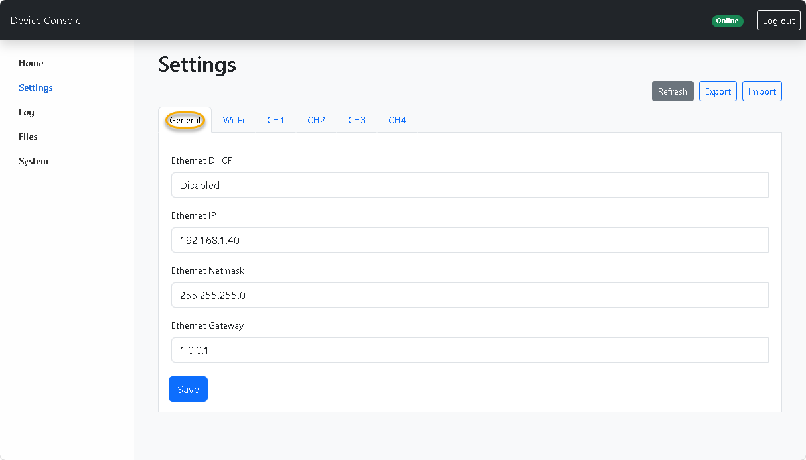

> **NOTE:**
> - DHCP may assign a different IP address and interrupt your Device Console connection.
> - To keep the device reachable at a known address, a **static** IP address is recommended.

#### 4.2.2 Wi-Fi [↑](#bookmarks "Back to Bookmarks")

Wi-Fi is available on the `TCP Modbus Gateway`. To connect to an existing
wireless network, the correct SSID, security type, and password must be
provided.

> **NOTE:**
> DHCP can be used, or a static IP address, netmask, and gateway can be configured.

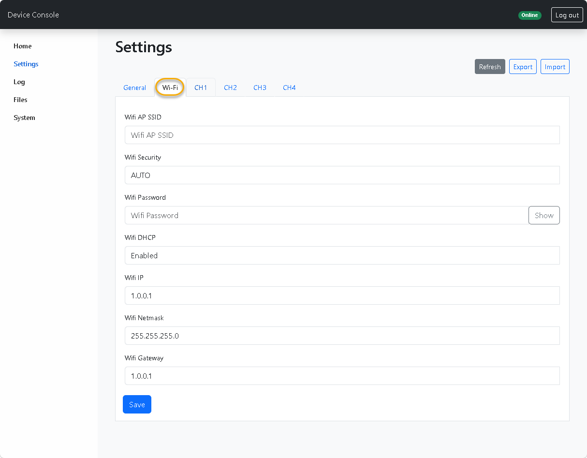

#### 4.2.3 Modbus channels [↑](#bookmarks "Back to Bookmarks")

The Device Console has one configuration group for each channel: **CH1**,
**CH2**, **CH3**, and **CH4**.

The **CH1** configuration group is shown below.

> **NOTE:**
> - Channels **CH2**, **CH3**, and **CH4** are configured in the same way, each with its own listening port and RTU settings.
> - All four channels can be configured to meet the requirements of the installation.

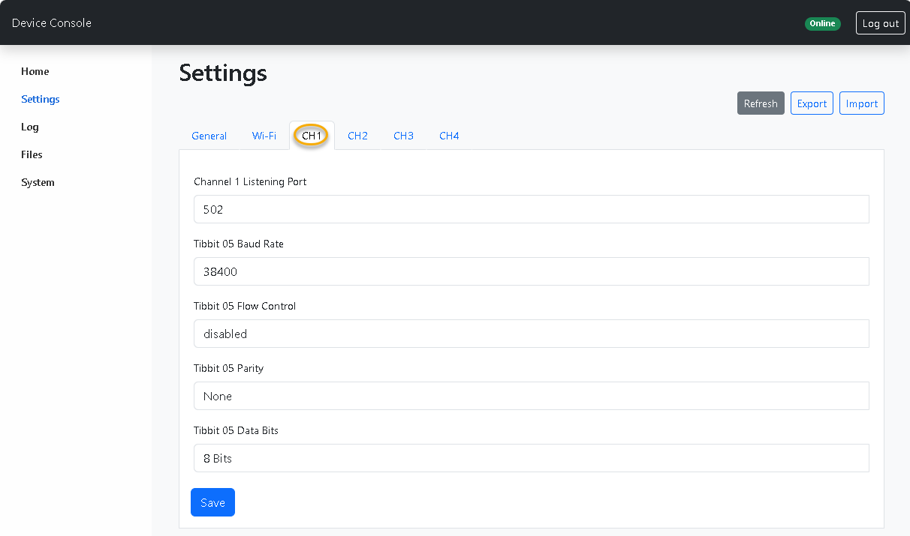

 

### 4.3 Log [↑](#bookmarks "Back to Bookmarks")

On the Log page, device log messages stored in Flash are shown in the
following groups:

- **Debug:** Detailed runtime diagnostic messages, including startup, network,
  storage, SNTP, and Modbus communication events and errors.
- **Log:** Reboot logs.

> **NOTE:** For each group, the entries show a timestamp and recorded value.

#### 4.3.1 Debug [↑](#bookmarks "Back to Bookmarks")

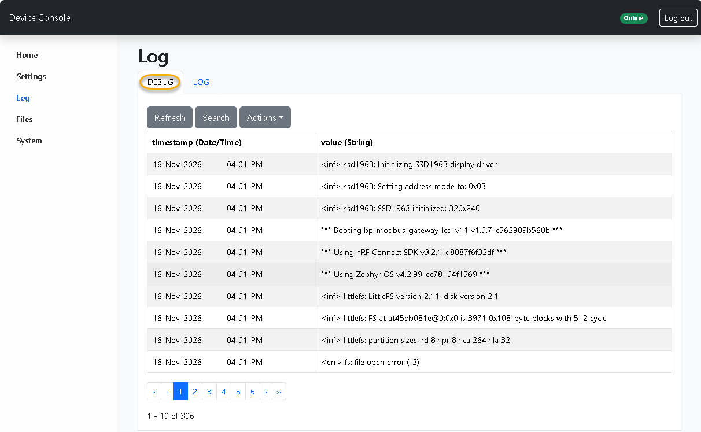

#### 4.3.2 Log [↑](#bookmarks "Back to Bookmarks")

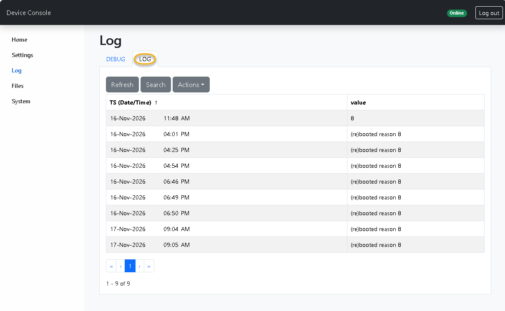

### 4.4 System [↑](#bookmarks "Back to Bookmarks")

The **System** tab contains the **Commands** and **Time** groups.

#### 4.4.1 Commands [↑](#bookmarks "Back to Bookmarks")

Let's take a look at the **Commands** group first. It provides controls to
restart the device or initialize its stored settings.

- **Reboot:** Restarts the gateway and applies the stored network and channel
  configuration.
- **Initialize Settings:** Restores the application settings to their default
  values. **A reboot is Required**.

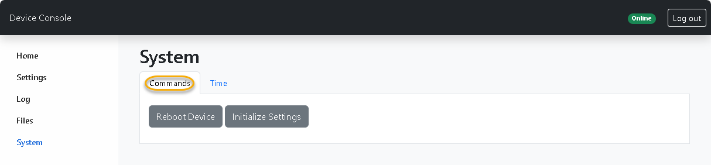

#### 4.4.2 Time [↑](#bookmarks "Back to Bookmarks")

The **Time** group shows the device time, time zone, daylight-saving status,
and last SNTP synchronization time.

The following controls are available:

- **Change:** Sets the device time manually.
- **Set to This Computer's Time:** Sets the device time from the computer
  running the Device Console.
- **Sync with SNTP Server:** Synchronizes the device time with the configured
  SNTP server.

> **NOTE:** If Sync with SNTP Server does not succeed, check the device’s network connection and make sure it has internet access.

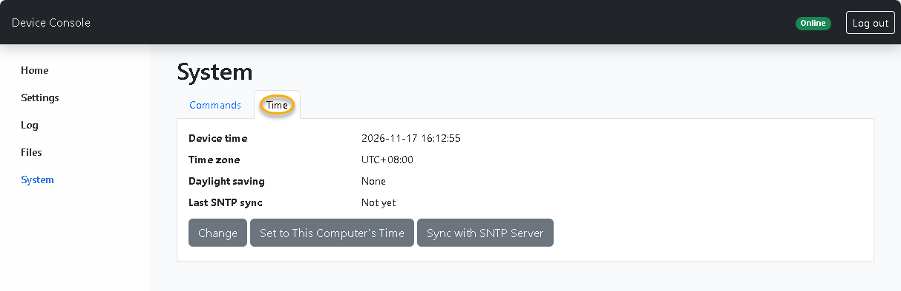

  

---

## 5. Deployment example [↑](#bookmarks "Back to Bookmarks")

This example configures CH1 so that a Modbus TCP client can reach a Modbus RTU
device on the RS-485 bus in Tibbit socket 1.

### 5.1 Connect the Modbus RTU devices [↑](#bookmarks "Back to Bookmarks")

The deployment steps use a Tibbo Modbus BP#02, a sensor for ambient
temperature and relative humidity. The BP#02 is used only as an example;
another compatible Modbus device can be connected instead.

> **IMPORTANT:** Before replacing a Modbus sensor or changing its wiring,
> disconnect power from the device. Reconnect power only after the new sensor
> and all wiring have been connected correctly.

Connect the BP#02 to the TPP2W(G2) as shown below. Connect each wire to the
terminal with the matching label: `VCC` to `VCC`, `GND` to `GND`, `Tx` to
`Tx`, and `Rx` to `Rx`. When using a different Modbus device, follow its
documentation for the required power and communication connections.

> **TIP:** More Tibbo RS-485 Modbus sensor models are available [here](https://tibbo.com/store/rs485-modbus-sensors.html).

 

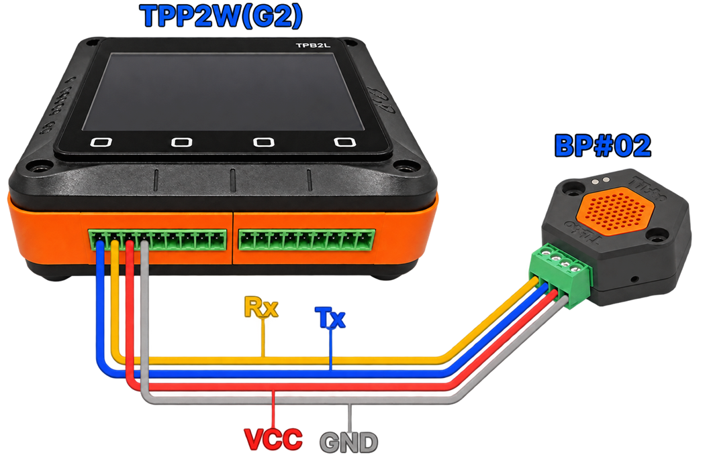

### 5.2 Connect the network and power [↑](#bookmarks "Back to Bookmarks")

Connect an Ethernet cable from the device's RJ45 port to your local network.
Then connect the supplied power adapter to the device. The device starts when
power is connected. Allow up to 20 seconds for the device to fully boot and
become ready for use.

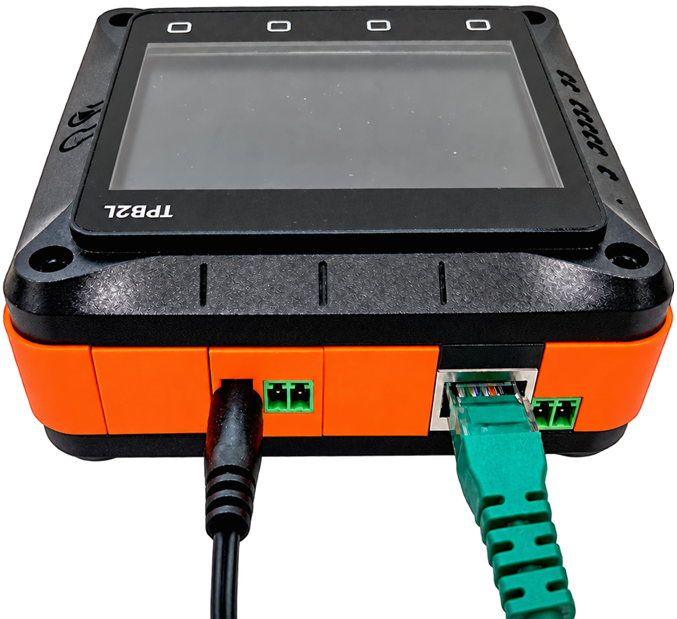

 

### 5.3 Connect to the Device Console [↑](#bookmarks "Back to Bookmarks")

Using your preferred web browser, navigate to [http://192.168.1.40](http://192.168.1.40). Shortly after, the **Home** page should be displayed (see [Section 4.1](#41-home)).

 

### 5.4 Configure General [↑](#bookmarks "Back to Bookmarks")

The **Ethernet** connection for the local network is configured in the
**General** group.

> **NOTE:**
> - This example uses the **default** Ethernet configuration.
> - If changes are required, see [Section 4.2.1](#421-general).

 

### 5.5 Configure Wi-Fi [↑](#bookmarks "Back to Bookmarks")

For this example, configure Wi-Fi by entering the SSID and password for the
wireless network in the **Wi-Fi** group. Leave all other Wi-Fi settings at
their default values.

> **NOTE:**
> For details about Wi-Fi settings, see [Section 4.2.2](#422-wi-fi).

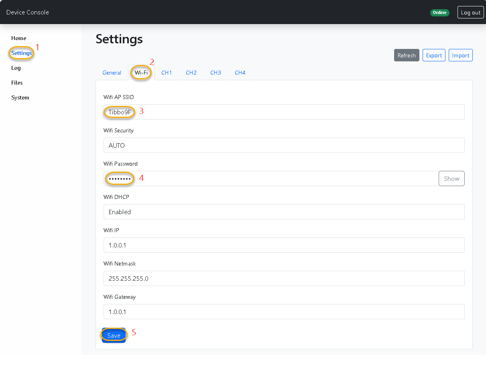

1. Select **Settings**.
2. Select **Wi-Fi**.
3. Enter the wireless network SSID.
4. Enter the wireless network password.
5. Select **Save**.

 

### 5.6 Configure Channels [↑](#bookmarks "Back to Bookmarks")

Only configure **CH1** by changing its TCP listening port to 10502.

> **NOTE:**
> - Leave CH2, CH3, and CH4 at their default values.
> - For details about channel settings, see [Section 4.2.3](#423-modbus-channels).

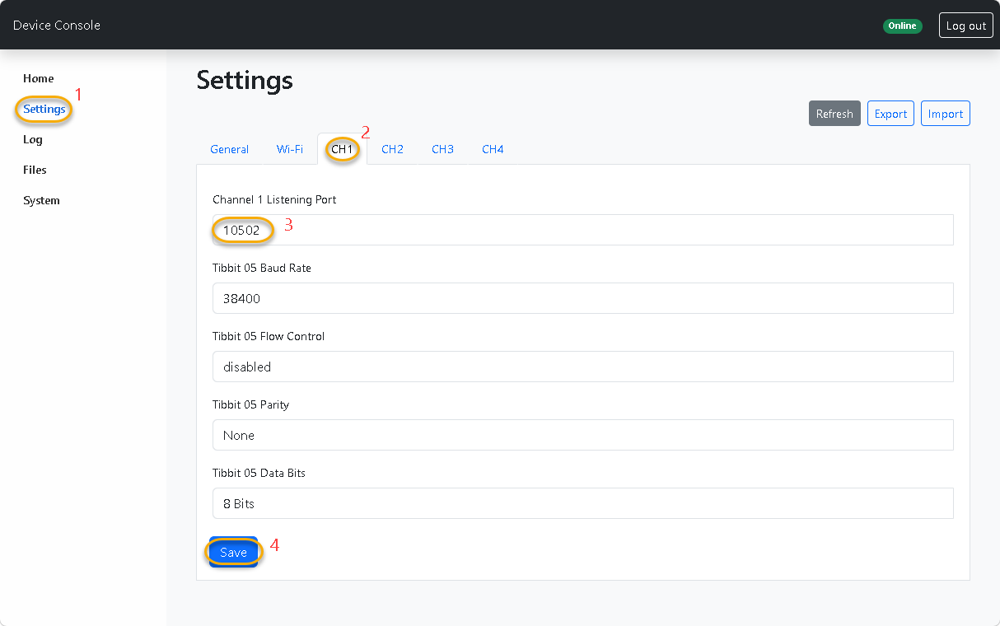

1. Select **Settings**.
2. Select **CH1**.
3. Set **Channel 1 Listening Port** to `10502`.
4. Select **Save**.

 

### 5.7 Reboot Device [↑](#bookmarks "Back to Bookmarks")

Restart the device so that the new configuration is applied. Allow up to
20 seconds for the device to fully boot and become ready for use.

> **NOTE:** For details about restarting the device, see
> [Section 4.4.1](#441-commands).

#### 5.7.1 Verify Wi-Fi Connection [↑](#bookmarks "Back to Bookmarks")

After the device has restarted, open the **Wi-Fi** group and select
**Refresh**. Confirm that a Wi-Fi IP address is displayed..

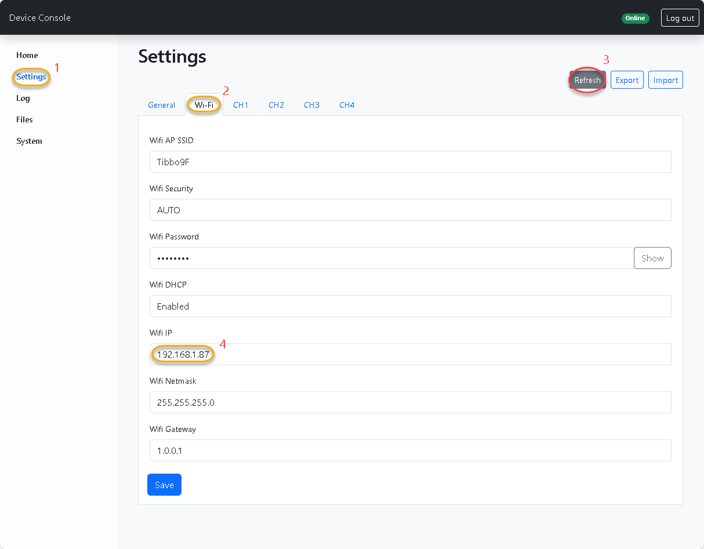

1. Select **Settings**.
2. Select **Wi-Fi**.
3. Click **Refresh**.
4. Check the Wi-Fi IP address.

> **NOTE:** 
> - If the Wi-Fi IP address has not changed, wait 5 seconds and click **Refresh** again.
> - In addition to the Ethernet IP address (for example, `192.168.1.40`), the Wi-Fi IP address can
> also be used to connect the TCP-to-Modbus test software

 

### 5.8 TCP-to-Modbus Test Software [↑](#bookmarks "Back to Bookmarks")

#### 5.8.1 Download and Install [↑](#bookmarks "Back to Bookmarks")

In this example, **PowerHud Modbus Tester** is used to send Modbus requests
through the gateway and receive responses from the connected field devices.

> **Download location:** [modbustester.com](https://www.modbustester.com/).

#### 5.8.2 Configuration [↑](#bookmarks "Back to Bookmarks")

Configure **PowerHud Modbus Tester** with:

- Ethernet IP address: `192.168.1.40`
- CH1 listening port: `10502`
- BP#02 Device-ID: `1`
- BP#02 Registry-Address-Range: `400 - 405`
- BP#02 Function-Code: `03 - Read Holding Registers`

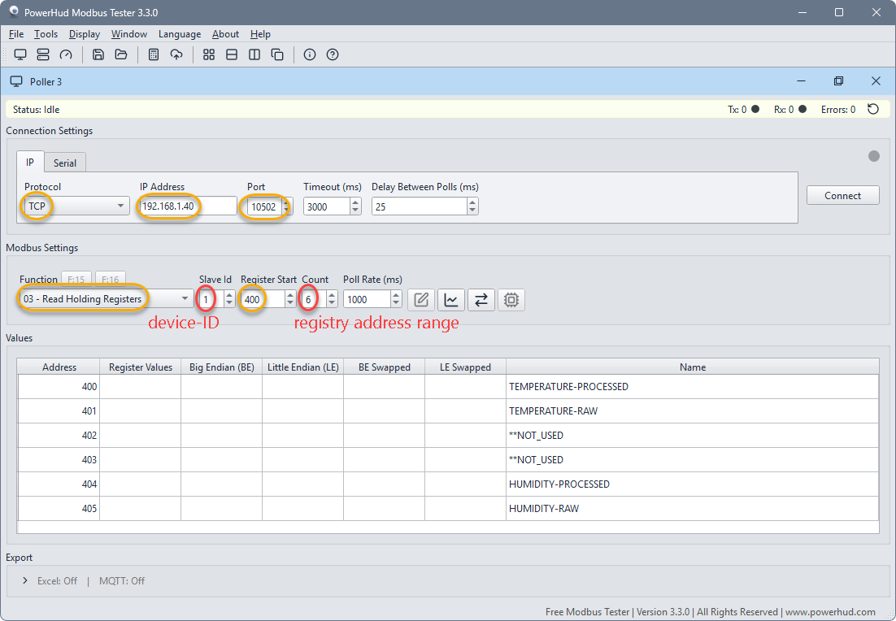

> **IMPORTANT:**
> - Select the correct function code for the connected field device.
> - A Modbus write sent through the gateway changes the field device;
>   use write functions only for approved control points and only when it is
>   safe to change the device state.

#### 5.8.3 Start Connection [↑](#bookmarks "Back to Bookmarks")

Click **Connect** to start polling Modbus data.

#### 5.8.4 Check Result [↑](#bookmarks "Back to Bookmarks")

Wait approximately 5 seconds, then check the polled Modbus data.

##### 5.8.4.1 Table [↑](#bookmarks "Back to Bookmarks")

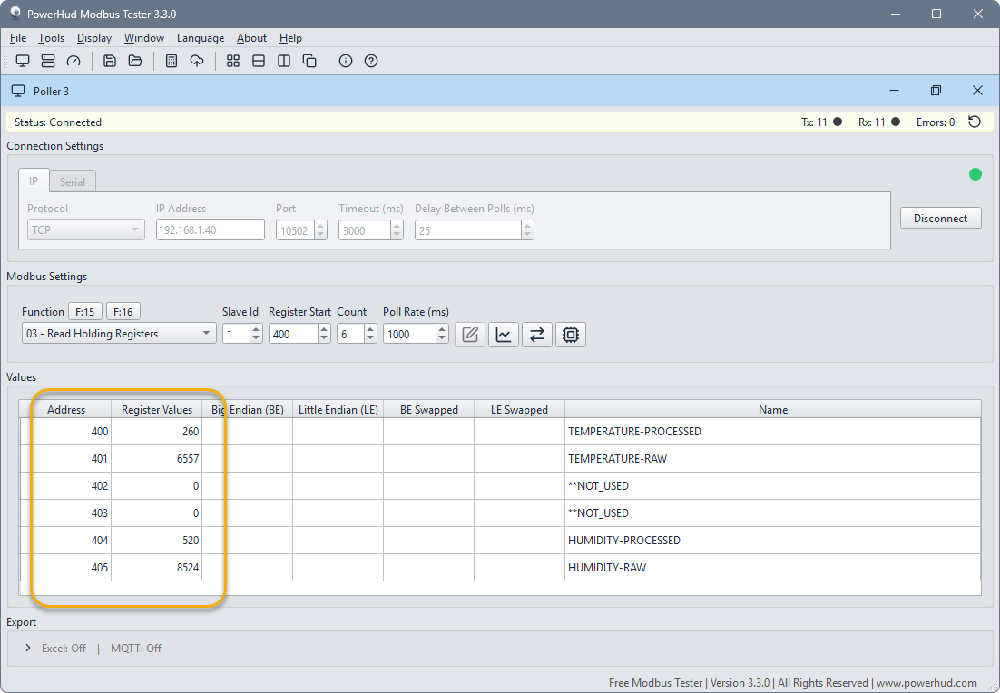

##### 5.8.4.2 Live Chart [↑](#bookmarks "Back to Bookmarks")

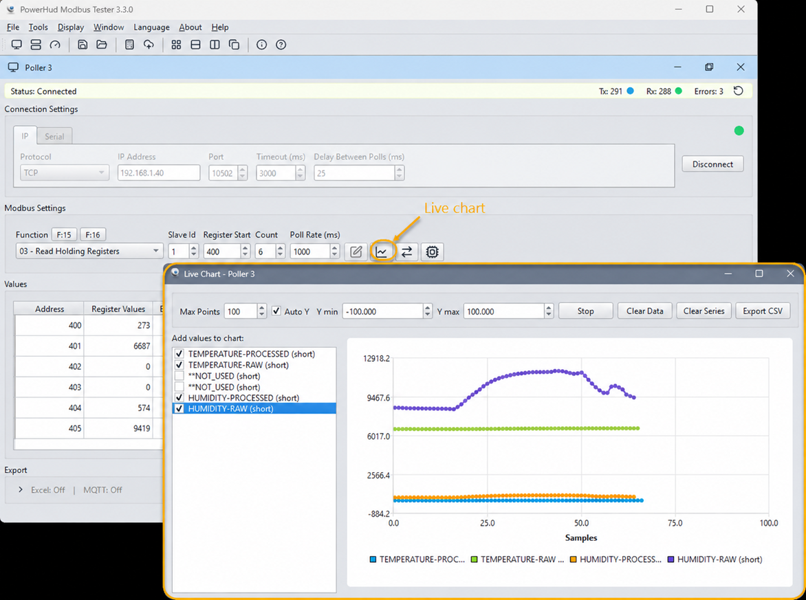

 

### 5.9 LCD Status [↑](#bookmarks "Back to Bookmarks")

The LCD displays the configured **Ethernet** IP address, **Wi-Fi** IP address, and the connection
status of **CH1**, **CH2**, **CH3**, and **CH4**.

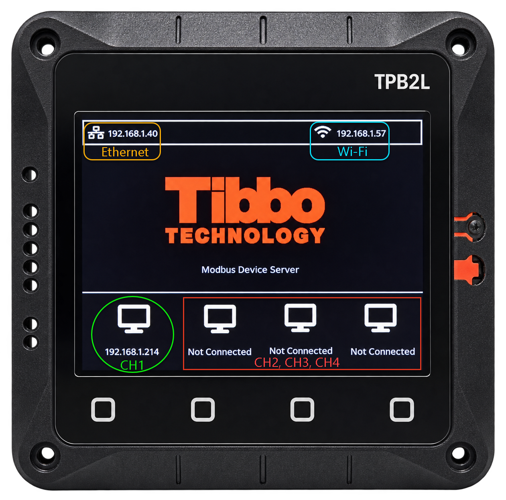

  

---

## 6. Commissioning checklist [↑](#bookmarks "Back to Bookmarks")

1. Install and check the RS-485 wiring.
2. Connect the Ethernet cable and power adapter. Wait for the device to boot.
3. Open the Device Console at the device's current IP address.
4. In **Device Console > Settings > General**, configure the Ethernet settings
   required by the local network.
5. In **Device Console > Settings > Wi-Fi**, configure the wireless network connection (if used).
6. In **Device Console > Settings > CH1–CH4**, configure the required channel
   listening ports and RTU settings.
7. Restart the device to apply the network and channel settings.

> **NOTE:**
> - If Wi-Fi is configured, in **Device Console > Settings > Wi-Fi**, confirm
>   that the displayed Wi-Fi IP address is correct.
> - If the IP address is incorrect or has not updated, click **Refresh**.

8. Gather the Modbus unit ID, function code, register range, data format, and
   expected values from the field-device documentation.
9. Configure the TCP-to-Modbus test software with the gateway IP address,
    channel listening port, and the collected Modbus communication parameters.
10. Start polling and confirm that the expected values are displayed in the
    table or Live Chart.
11. Confirm that the LCD shows the configured Ethernet IP address, Wi-Fi IP
    address, and channel connection statuses.

  

---

## 7. Troubleshooting [↑](#bookmarks "Back to Bookmarks")

| Symptom | Checks |
| --- | --- |
| Cannot open the Device Console | Confirm the gateway IP address on the LCD or DHCP server, verify network reachability, and use HTTP port `80`. |
| No Ethernet address is assigned | Check the Ethernet cable, switch port, and DHCP-server availability. If DHCP is disabled, verify the static IP, netmask, and gateway. |
| Wi-Fi does not connect | Verify the SSID, password, security mode, signal coverage, and DHCP or static IPv4 settings. Restart after changing Wi-Fi settings. |
| Modbus TCP client cannot connect | Verify the gateway IP address, selected TCP port, firewall rules, and that the listening port is not duplicated by another channel. |
| Modbus TCP request times out | Check RS-485 wiring and polarity, RTU baud rate, field-device power, unit ID, termination/biasing, and the selected channel/socket. |
| Gateway returns a target-device failure exception | The RTU device did not reply before the gateway timeout. Check the serial bus and field-device configuration. |
| Gateway returns a busy exception | Reduce request rate or retry the request. The gateway has a limited queue for pending TCP-to-RTU transactions. |
| Read value is incorrect | Verify the function code, register address, unit ID, data type, scaling, and byte/word order in the field-device register map. |
| Changed configuration does not take effect | Save the settings, then restart the gateway. |
| MD button does not reset settings | This firmware assigns an audible indication to the MD button. Use the Device Console's **Initialize Settings** control instead. |
